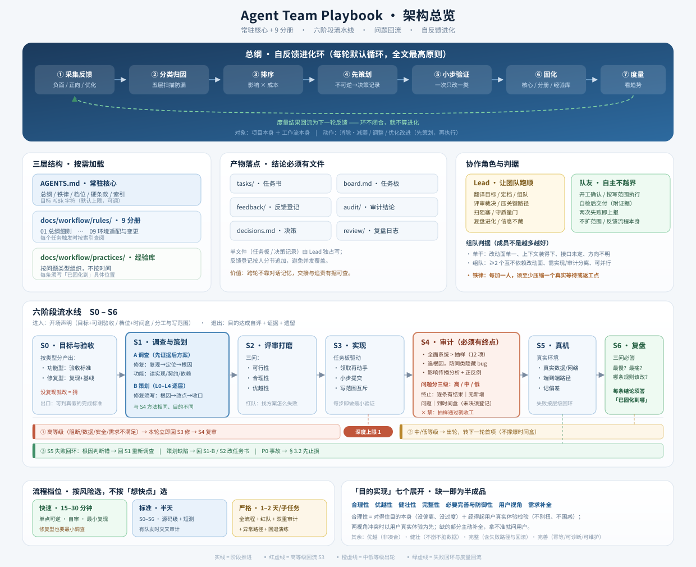

# Agent Team Playbook · Multi-Agent Collaboration Workflow

[中文](README.md) | English

> [](https://www.npmjs.com/package/dsh-agent-team-playbook)
> [](LICENSE)
> 

A complete collaboration protocol for teams of one Lead plus several AI teammates: how to size a task, split the work, write a brief, audit, accept, and retro.

Not a prompt collection — **executable process and gates**: every rule maps to a checkable action and a file where its result lands.

```
dsh plugin --profile web add dsh-agent-team-playbook   # command + web panel (writes nothing)
npx dsh-agent-team-playbook init                       # or install as resident context (writes AGENTS.md + docs/)
```

## What it fixes

Multi-agent work rarely fails because the model is not smart enough. It fails because:

- no completion criteria were set, so the work is discovered to be wrong only at the end
- no write-scope exclusivity, so two teammates overwrite each other's file
- auditing is skipped and the debugging cost is pushed onto real hardware
- conclusions live only in the chat and are gone by the next round
- the same pit is stepped in three times because nobody did a root-cause pass

This repository turns those lessons into clauses, templates and checklists.

## Structure

```
AGENTS.md                     resident core (<=8k chars): charter, iron rules, tier table, hard clauses, index
docs/workflow/rules/          detail volumes, read on demand (9 of them)
docs/workflow/practices/      experience library, organised by problem type
```

Design rule: **the core file only does three things — state principles, give quick reference, point the way**. Low-frequency detail moves down into volumes, the core keeps a trigger line.

### Volumes

| # | Contents |
|---|---|
| 01 | Charter in detail |
| 02 | Efficiency and tiering |
| 03 | Pipeline S0–S6 (incl. S1 investigation, S4 severity and reflow), audit checklist, incident aftermath |
| 04 | Task brief template |
| 05 | Task board |
| 06 | Collaboration rules (Lead/teammate duties, communication) |
| 07 | User interaction and metrics |
| 08 | Anti-patterns and quick reference |
| 09 | Environment adaptation and change log |

## Core mechanics

1. **Charter: feedback-driven** — keep collecting feedback while working, then remove or weaken obstacles, adjust and improve according to it; the object includes both *the project* and *the workflow itself*; plan first, then execute.
2. **Flow tiers** — Quick (single point, reversible, 15–30 min) / Standard (regular features and fixes, half a day) / Strict (data, payments, security, irreversible, 1–2 days). Escalate on: touching data, changing an external contract, touching shared files, failing twice in the same place, adding a dependency, unexplained real-device failure.
3. **Three kinds of feedback** — negative: find the root cause and remove it; positive: distil and amplify (into templates, checklist items, tests); direction: weigh value against cost.
4. **Six-stage pipeline** — S0 goal and acceptance → S1 investigation and planning → S2 review (four questions) → S3 implementation → S4 audit (systematic + root cause, issues graded high/medium/low) → S5 CI gate and real-device verification (parallel, AND-joined) → S6 retro and codification.
5. **Experience must land** — route by frequency into core clauses / volumes / experience library; every entry must name *where it was codified*.

Details live in [`AGENTS.md`](AGENTS.md) and its §8 index.

## Architecture



One picture: the **self-feedback evolution loop** (top, the highest principle) → **three-layer structure and artefacts** (middle) → **six-stage pipeline S0–S6** (bottom) → **issue reflow and failure loops** (dashed).

## When it fits, when it does not

**Fits**: multi-file changes, parallel teammates, data or release risk, work handed across rounds.

**Does not fit**: one-off scripts and exploratory spikes — use the Quick tier and do not add process for its own sake.

## Install

### Option A: DSH plugin (command + panel, writes nothing)

```bash
dsh plugin --profile web add dsh-agent-team-playbook
```

Adds an `/atp` command; on web and desktop there is also a panel.

| Command | Purpose |
|---|---|
| `/atp` | Protocol summary (tiers, four review questions, three retro questions) plus install options |
| `/atp core` | Print the full core text and follow it for the current turn |
| `/atp paths` | Absolute paths of the volumes, to read on demand |
| `/atp install` | Install the playbook into the current workspace, atomically |
| `/atp install force` | Overwrite same-name content and install |
| `/atp apply 1=overwrite 2=backup 3=rename:x` | Decide conflicts item by item |
| `/atp help` | Usage |

**Panel** (web / desktop): a “Playbook” chip on the home row (with a count when conflicts exist) and Settings → Playbook.

Existing files are never overwritten silently: you get a conflict list and choose **overwrite / back up / rename** per item, and the run is applied after you finish.
(The dsh-go native mobile UI does not load browser halves; use the command there.)

### Option B: install as resident context (writes files, the real payoff)

```bash
npx dsh-agent-team-playbook init --dry-run               # see the plan first
npx dsh-agent-team-playbook init                         # install into the current project
npx dsh-agent-team-playbook init --global                # user-global: managed block (pointer)
npx dsh-agent-team-playbook init --global --inline-core  # user-global: inlined core (truly resident)
```

| Mode | Effect | Resident cost |
|---|---|---|
| `init` (project) | Writes `<project>/AGENTS.md` + `docs/`, injected by DSH every turn | ~5.3k chars/turn |
| `init --global` | Copies to `$DSH_HOME/agent-team-playbook/`, maintains a managed block in `$DSH_HOME/AGENTS.md` (pointer) | ~300 chars/turn |
| `init --global --inline-core` | Same, but the block inlines the core text | ~6.3k chars/turn |

When a same-name file exists you are asked **item by item** (overwrite / rename / skip / all overwrite / abort); nothing is overwritten silently, and non-interactive contexts abort by default. Choosing rename rewrites references inside the documents, so no links break.

### Which option to use

| You want | Use |
|---|---|
| Look up the protocol now and then, without paying context | Option A (zero context cost) |
| The agent to **follow it every turn** | Option B (truly resident) |
| It applied globally, not per project | `init --global` |

## Quick start

1. Install (Option A or B)
2. Adjust environment-specific parts per `docs/workflow/rules/09-环境适配与变更记录.md`
3. Start the first task on the Standard tier; after one round, trim or tighten based on the retro
4. Read volumes on demand through the `AGENTS.md` §8 index — full reading is not required

## More

| | |
|---|---|
| Version history | [CHANGELOG](CHANGELOG.md) · [Releases](https://github.com/ChongCyrus/agent-team-playbook/releases) |
| Development | [CONTRIBUTING](CONTRIBUTING.md) (self-check, compatibility range, release flow) |
| Full protocol | [`AGENTS.md`](AGENTS.md) · [`docs/workflow/`](docs/workflow/) |

## License

MIT, see [LICENSE](LICENSE).
