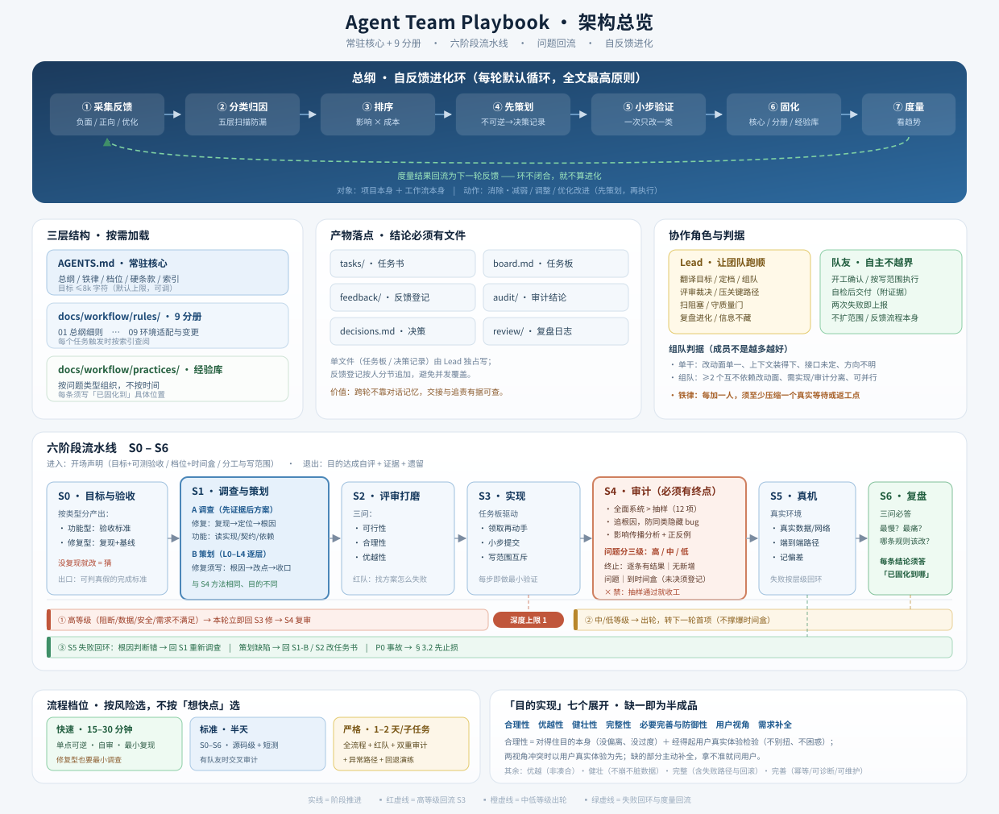

# Agent Team Playbook · 多智能体协作工作流

中文 | [English](README.en.md)

> [](https://www.npmjs.com/package/dsh-agent-team-playbook)
> [](LICENSE)
> 

给「Lead + 多名 AI 队友」用的一整套协作规程：怎么定档、怎么分工、怎么写任务书、怎么审计、怎么验收、怎么复盘。

不是提示词合集，而是**可执行的流程与门禁**——每条规则都对应一个可判真假的动作和落点文件。

```
dsh plugin --profile web add dsh-agent-team-playbook   # 装命令 + Web 面板（不写文件）
npx dsh-agent-team-playbook init                       # 或装成常驻上下文（写 AGENTS.md + docs/）
```

## 它解决什么

多智能体协作的失败，几乎都不是"模型不够聪明"，而是：

- 没定完成标准，做完才发现方向错
- 没有写范围互斥，两个队友改同一文件互相覆盖
- 跳过审计直接验证，把调试成本转移到真机上
- 结论只存在对话里，跨轮就失效
- 同一个坑连踩三次，因为没人做根因分析

本仓库把这些教训固化成条款、模板和检查清单。

## 三层结构

```
AGENTS.md                     常驻核心（≤8k 字符）：总纲、铁律、档位速查、硬条款、索引
docs/workflow/rules/          分册细则（按需查阅，共 9 册）
docs/workflow/practices/      经验与做法库（按问题类型组织）
```

设计原则：**正文只做三件事——立原则、给速查、指路**；低频细则下沉分册，正文留触发点。

### 分册目录

| 册 | 内容 |
|---|---|
| 01 | 总纲细则 |
| 02 | 效率与档位详解 |
| 03 | 流水线 S0–S6（含 S1 调查、S4 问题分级与回流）、审计清单、事故善后 |
| 04 | 任务书模板 |
| 05 | 任务板 |
| 06 | 协作细则（Lead/队友职责、沟通） |
| 07 | 用户交互与度量 |
| 08 | 反模式与速查 |
| 09 | 环境适配与变更记录 |

## 核心机制

1. **总纲：反馈驱动** —— 过程中不断获取反馈，按实际反馈做障碍消除/减弱、调整、优化改进；对象同时包括「项目本身」与「工作流本身」；先策划，再执行。
2. **流程档位** —— 快速（单点可逆，15–30 分钟）/ 标准（常规功能与修复，半天）/ 严格（数据、支付、安全、不可逆，1–2 天）。升档触发：动数据、改对外契约、触共享文件、同一处两次修不好、新增依赖、真机失败原因不明。
3. **反馈三类** —— 负面定根因消除；正向提炼放大（写进模板/检查项/测试）；优化方向评估价值与成本。
4. **六阶段流水线** —— S0 目标与验收 → S1 调查与策划 → S2 评审四问 → S3 实现 → S4 审计（全面系统 + 追根因，问题按高/中/低分级）→ S5 CI/CD 门禁与真机验证（可并行，判定为 AND）→ S6 复盘固化。S4/S5 也可并行。
5. **经验要落地** —— 按使用频率分流到核心条款 / 分册 / 经验库，每条必须写「已固化到」具体位置。

细则见 [`AGENTS.md`](AGENTS.md) 与其 §8 索引；架构图见下。

## 架构总览



一张图看懂：**自反馈进化环**（顶部，全文最高原则）→ **三层结构与产物落点**（中部）→ **六阶段流水线 S0–S6**（下部）→ **问题回流与失败回环**（虚线）。

## 适用与不适用

**适用**：多文件改动、需要并行队友、有数据/发布风险、需要跨轮交接的项目。

**不适用**：一次性脚本、探索性实验——直接用「快速档」，不要为了流程而流程。

## 安装

### 方式 A：DSH 插件（命令 + 面板，不写文件）

```bash
dsh plugin --profile web add dsh-agent-team-playbook
```

装好后多一个 `/atp` 命令，Web / 桌面端另有面板。

| 命令 | 作用 |
|---|---|
| `/atp` | 规程摘要（档位、四问、收尾三问）+ 安装方式 |
| `/atp core` | 输出核心全文，读完即在本轮按它协作 |
| `/atp paths` | 各分册的绝对路径，按需查阅 |
| `/atp install` | 把 playbook 原子安装进当前工作区 |
| `/atp install force` | 覆盖同名内容后安装 |
| `/atp apply 1=覆盖 2=备份 3=改名:x` | 对冲突逐项决定 |
| `/atp help` | 用法 |

**面板**（Web / 桌面端）：首页 chip 行的「协作规程」（有冲突时显示数量）+ 设置 → 协作规程。

遇到同名文件时不会静默覆盖：会列出冲突，让你逐项选 **覆盖 / 备份 / 改名**，处理完自动执行。
（dsh-go 手机原生界面不加载浏览器半身，那边用命令即可。）

### 方式 B：装成"常驻上下文"（会写文件，核心价值）

```bash
npx dsh-agent-team-playbook init --dry-run               # 先看计划
npx dsh-agent-team-playbook init                         # 装进当前项目
npx dsh-agent-team-playbook init --global                # 用户全局：受管区块（指针）
npx dsh-agent-team-playbook init --global --inline-core  # 用户全局：内联核心全文（真常驻）
```

| 方式 | 效果 | 常驻成本 |
|---|---|---|
| `init`（项目级） | 写 `<项目>/AGENTS.md` + `docs/` → DSH 每轮自动注入 | 约 5.3k 字符/轮 |
| `init --global` | 复制到 `$DSH_HOME/agent-team-playbook/`，在 `$DSH_HOME/AGENTS.md` 维护受管区块（指针） | 约 300 字符/轮 |
| `init --global --inline-core` | 同上，但区块内联核心全文 | 约 6.3k 字符/轮 |

已有同名文件时**逐个询问**（覆盖 / 改名 / 跳过 / 全部覆盖 / 中止），绝不静默覆盖；管道或 CI 等非交互环境下默认中止。选「改名」会自动改写文档内的引用，不留断链。

### 什么时候用哪种

| 你想要 | 用哪种 |
|---|---|
| 随时查规程、按需取，不想让它常驻 | 方式 A（0 上下文成本） |
| 让 agent **每轮都遵守** | 方式 B（真常驻） |
| 全局生效、不想每个项目都装 | `init --global` |

## 快速开始

1. 装好（方式 A 或 B）
2. 按 `docs/workflow/rules/09-环境适配与变更记录.md` 调整环境相关部分
3. 第一次任务从「标准档」起步，跑完一轮后按复盘结论裁剪或加严
4. 细则按 `AGENTS.md` §8 索引"条件必达"查阅，不要求全量通读

## 更多

| | |
|---|---|
| 版本历史 | [CHANGELOG](CHANGELOG.md) · [Releases](https://github.com/ChongCyrus/agent-team-playbook/releases) |
| 开发与发版 | [CONTRIBUTING](CONTRIBUTING.md)（自检、兼容范围、发布流程） |
| 规程全文 | [`AGENTS.md`](AGENTS.md) · [`docs/workflow/`](docs/workflow/) |

## License

MIT，见 [LICENSE](LICENSE)。
